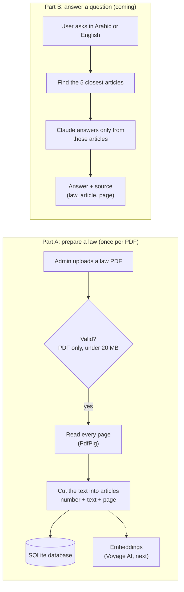

# ⚖️ Labor Law Assistant

An ASP.NET Core MVC web app that answers labor-law questions in **Arabic and English** from the official law text, and shows **the article and the page** each answer comes from.

It uses **RAG** (Retrieval-Augmented Generation): the app first finds the law articles that match the question, then gives only those articles to Claude, so the answer is based on the real law and always has a source.

> ⚠️ This app gives information, not legal advice.


## Status

| Feature | Status |
|---|---|
| Upload a law PDF (validation: PDF only, max 20 MB) | ✅ Done |
| Read the PDF and cut it into articles, each with its page number | ✅ Done |
| Browse the articles of a law (grid + pagination) | ✅ Done |
| English / Arabic interface (right-to-left) and dark mode | ✅ Done |
| Embeddings for every article (Voyage AI) | 🔄 Next |
| Ask a question → answer with sources (Claude) | ⬜ Coming |
| History of questions and answers | ⬜ Coming |

The law included for now is the **UAE Labour Law** (Federal Decree-Law No. 33 of 2021, English). You can upload other labor laws (for example Saudi Arabia) with no code change.

## Screenshots

| Articles of a law (grid + pagination) | Dark mode |
|---|---|
|  |  |

| Uploaded laws | Arabic + dark mode |
|---|---|
|  |  |

## How it works



A step-by-step explanation with flowcharts is in [docs/system-flow.pdf](docs/system-flow.pdf).

## Tech stack

- **ASP.NET Core MVC (.NET 10):** controllers, Razor views with a layout view, model binding, model validation, dependency injection
- **EF Core + SQLite:** the database is a single file, `laborlaw.db`
- **PdfPig:** reads the text of PDF files
- **Bootstrap 5.3:** layout, right-to-left support for Arabic, dark mode
- **Voyage AI:** embeddings (coming)
- **Claude API** (Anthropic C# SDK) with citations: answers (coming)

## Getting started

### 1. Install

- [.NET 10 SDK](https://dotnet.microsoft.com/download)
- The EF Core command-line tool:
  ```bash
  dotnet tool install --global dotnet-ef
  ```
- Optional: [DBeaver](https://dbeaver.io/) (or any SQLite viewer) to look inside the database

### 2. Get the code

```bash
git clone https://github.com/AliYasser1230/labor-law-assistant.git
cd labor-law-assistant/src/LaborLawAssistant
```

### 3. Create the database

```bash
dotnet ef database update
```

This creates `laborlaw.db` with all the tables.

### 4. Add your API keys (for the AI features)

The keys are stored with .NET user-secrets, outside the project folder, so they are never pushed to GitHub.

```bash
dotnet user-secrets set "Anthropic:ApiKey" "your-anthropic-key"
dotnet user-secrets set "VoyageAI:ApiKey" "your-voyage-key"
```

You can get keys at [console.anthropic.com](https://console.anthropic.com) and [dashboard.voyageai.com](https://dashboard.voyageai.com). Uploading and browsing laws work without keys.

### 5. Run

```bash
dotnet run
```

Open **http://localhost:5190** in your browser.

## How to use

1. **Upload a law:** go to **Documents → Upload a law PDF**. Choose the country, type the law's title, and choose the PDF.
   - The PDF must contain text (not a scanned image), and its articles must start with headings like `Article 1` or `Article (1)`.
   - The app reads the PDF, finds every article, and shows how many it found.
2. **Check the articles:** on the **Documents** page, click the law's title. Each article is shown as a card with its number, title, page and text, 12 articles per page.
3. **Ask a question:** coming soon on the **Ask** page.
4. **Language and theme:** use the **العربية / English** button to switch the language, and **🌙 / ☀️** to switch between light and dark mode.

## Where the data is saved

| What | Where |
|---|---|
| Database (laws, articles, questions) | `src/LaborLawAssistant/laborlaw.db` (open it with DBeaver: new connection → SQLite → choose this file) |
| Uploaded PDF files | `src/LaborLawAssistant/App_Data/LawPdfs/` (each file gets a random name) |
| API keys | .NET user-secrets on your computer |

The database, the uploaded PDFs and the keys are not part of the repository.

## Project structure

```
src/LaborLawAssistant/
├── Controllers/    Home, Documents (list, upload, articles), Ask, History, Language
├── Models/         Database tables: LawDocument, LawArticle, QuestionLog, Country
├── ViewModels/     Data for the pages and forms (with validation rules)
├── Validation/     Custom validation: PdfFile, MaxFileSize
├── Services/       DocumentStorage, PdfTextExtractor, ArticleSplitter, LawDocumentImporter
├── Data/           AppDbContext (EF Core)
├── Migrations/     Database changes (EF Core migrations)
├── Resources/      Arabic translations
├── Views/          Razor views + _Layout
└── wwwroot/        CSS, JavaScript, Bootstrap
```

## Roadmap

- Embeddings with Voyage AI, then question answering with Claude (with article + page citations)
- History page (question, answer, time, cost)
- More countries (Saudi Arabia, Egypt)
- Admin login, Docker, and deployment to Google Cloud Run

## Law sources

- UAE Labour Law (Federal Decree-Law No. 33 of 2021), English text from [FAOLEX](https://faolex.fao.org/docs/pdf/uae217212E.pdf). This English copy is marked "not an official translation"; the Arabic text is the official one.
