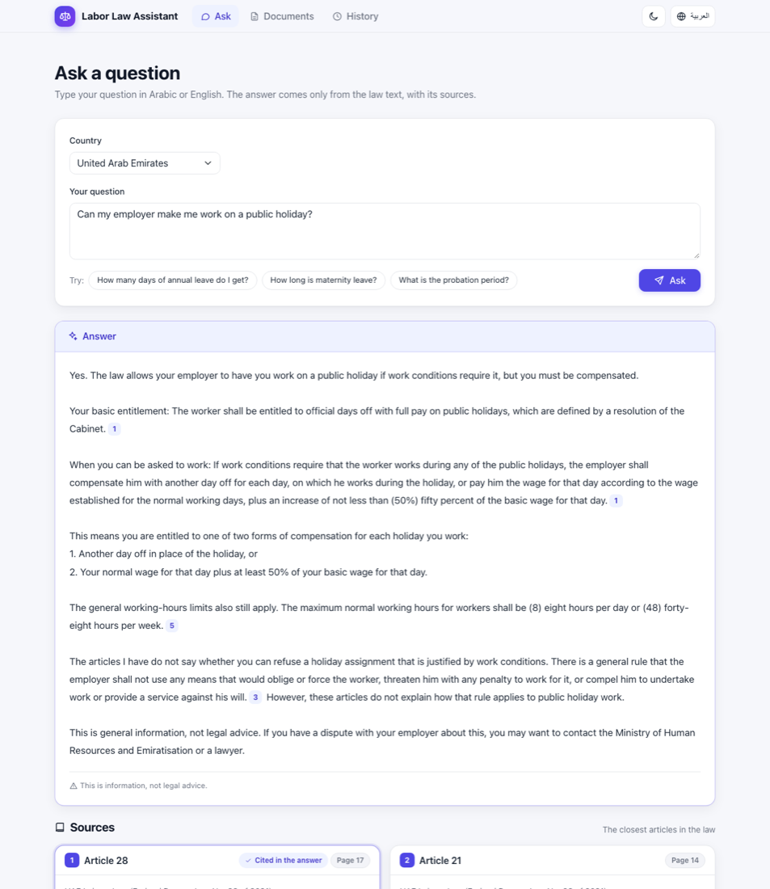
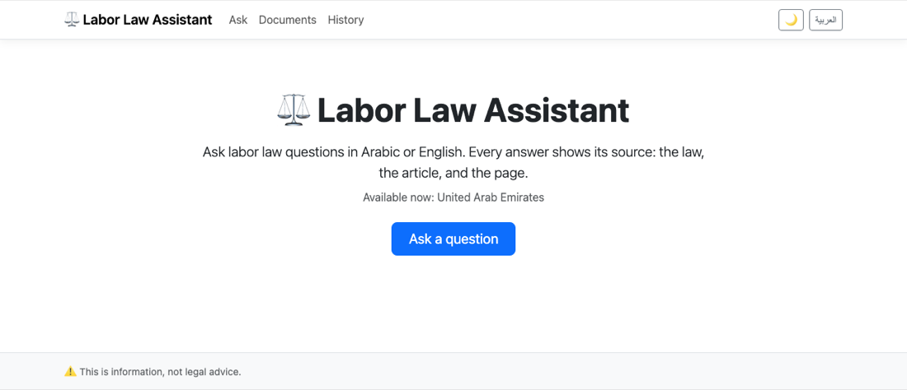
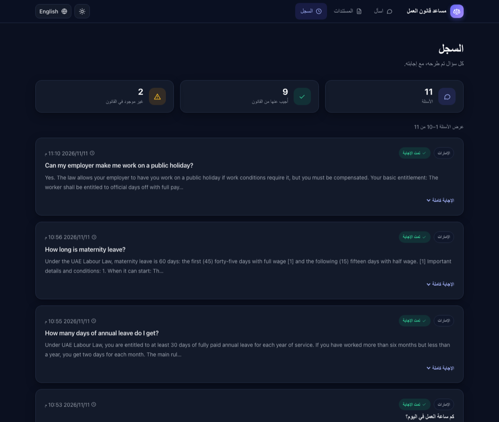
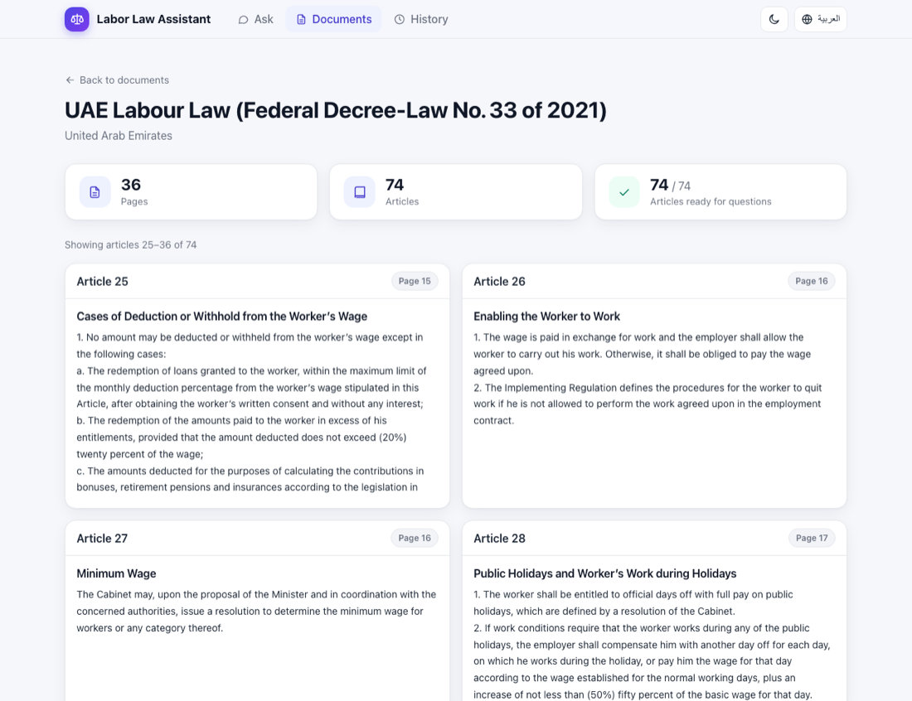
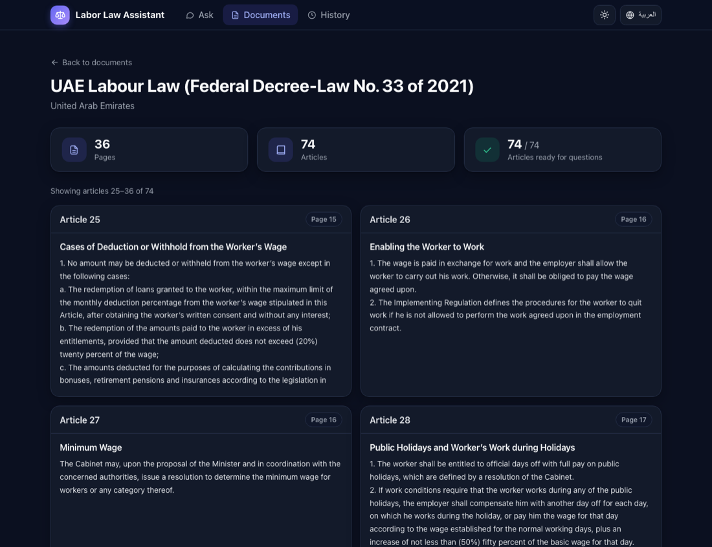
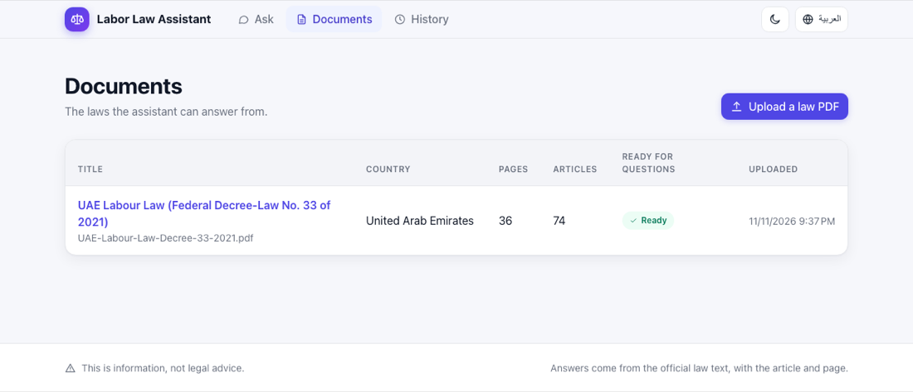
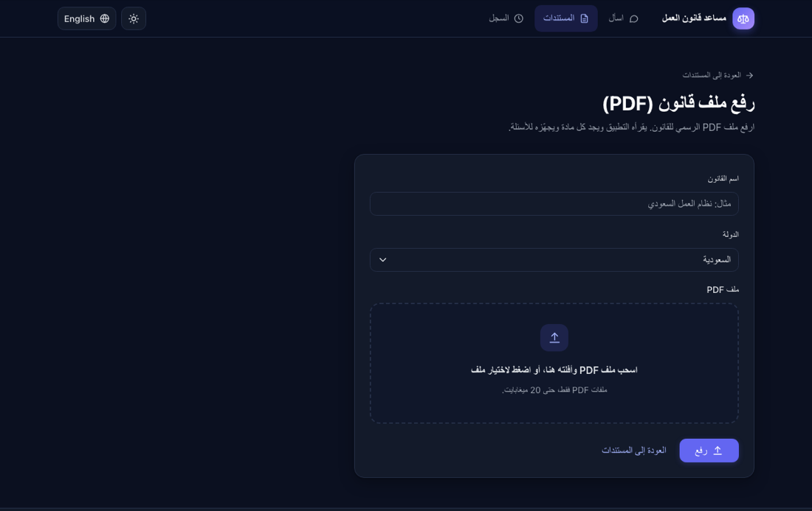
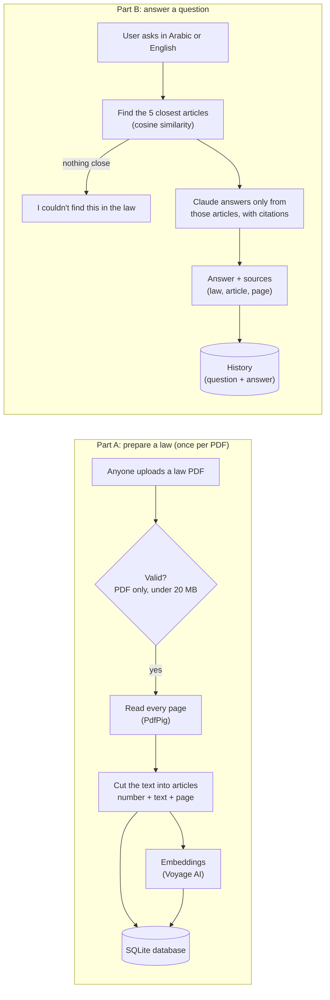

# ⚖️ Labor Law Assistant

An ASP.NET Core MVC web app that answers labor-law questions in **Arabic and English** from the official law text, and shows **the article and the page** each answer comes from.

It uses **RAG** (Retrieval-Augmented Generation): the app first finds the law articles that match the question, then gives only those articles to Claude, so the answer is based on the real law and always has a source.

> ⚠️ This app gives information, not legal advice.



## Status

| Feature | Status |
|---|---|
| Upload a law PDF (validation: PDF only, max 20 MB) | ✅ Done |
| Read the PDF and cut it into articles, each with its page number | ✅ Done |
| Browse the articles of a law (grid + pagination) | ✅ Done |
| English / Arabic interface (right-to-left) and dark mode | ✅ Done |
| Embeddings for every article (Voyage AI) | ✅ Done |
| Ask a question → find the 5 closest articles (works across Arabic and English) | ✅ Done |
| Claude writes the answer from those articles, each part linked to its source article | ✅ Done |
| History page: every question with its answer and time (with pagination) | ✅ Done |
| Ready for the cloud: Docker, PostgreSQL, Google Cloud Storage, Secret Manager, Cloud Run deploy script | ✅ Code ready (not deployed) |

The law included for now is the **UAE Labour Law** (Federal Decree-Law No. 33 of 2021, English). You can upload other labor laws (for example Saudi Arabia) with no code change.

## Screenshots

| Home page | History (Arabic + dark mode) |
|---|---|
|  |  |

| Articles of a law (grid + pagination) | Dark mode |
|---|---|
|  |  |

| Uploaded laws | Arabic + dark mode |
|---|---|
|  |  |

## How it works



A step-by-step explanation with flowcharts is in [docs/system-flow.pdf](docs/system-flow.pdf).

## Tech stack

- **ASP.NET Core MVC (.NET 10):** controllers, Razor views with a layout view, model binding, model validation, dependency injection
- **EF Core + SQLite** on your computer (one file, `laborlaw.db`), **PostgreSQL** in the cloud; tables are created automatically at startup
- **Semantic search:** cosine similarity in C# between the question's embedding and every article's embedding
- **PdfPig:** reads the text of PDF files
- **Bootstrap 5.3** with a custom theme (CSS variables): right-to-left support for Arabic, light and dark mode
- **Custom Tag Helper** (`<icon name="..." />`) for the line icons, so no icon library is needed
- **Voyage AI** (`voyage-4`): embeddings, 1024 numbers per article, called through a typed `HttpClient`
- **Claude API** (`claude-opus-5-5`, official Anthropic C# SDK): answers with citations, so each part of the answer is linked to the article it comes from
- **Cloud (optional):** Docker, Google Cloud Run, Cloud SQL (PostgreSQL), Cloud Storage, Secret Manager

## Getting started

### 1. Install

- [.NET 10 SDK](https://dotnet.microsoft.com/download)
- Optional: [DBeaver](https://dbeaver.io/) (or any SQLite viewer) to look inside the database

### 2. Get the code

```bash
git clone https://github.com/AliYasser1230/labor-law-assistant.git
cd labor-law-assistant/src/LaborLawAssistant
```

### 3. Build

```bash
dotnet build
```

This downloads the NuGet packages and compiles the app. You don't need to create the database: the app creates `laborlaw.db` with all its tables the first time it starts.

### 4. Get your own API keys

This repository contains **no API keys**. To run the app, you need **your own** keys from two services (create an account on each):

| Key | What the app uses it for | Where to get it | Price |
|---|---|---|---|
| **Anthropic** (Claude) | Writes the answers | [console.anthropic.com](https://console.anthropic.com) → **API Keys** → **Create Key** (add a little credit in **Billing**) | About 3–5 US cents per answer with `claude-opus-5-5` |
| **Voyage AI** | Turns articles and questions into embeddings for the search | [dashboard.voyageai.com](https://dashboard.voyageai.com) → **API Keys** → **Create new secret key** | The first 200 million tokens are free |

Keep your keys private: never put them in the code, in `appsettings.json`, or in a commit.

### 5. Save your keys on your computer

Run these commands inside `src/LaborLawAssistant`, with your own keys:

```bash
dotnet user-secrets set "Anthropic:ApiKey" "your-anthropic-key"
dotnet user-secrets set "VoyageAI:ApiKey" "your-voyage-key"
```

.NET **user-secrets** saves them in a private file in your user folder, outside the project, so they can never be pushed to GitHub. To check what is saved: `dotnet user-secrets list`.

On a server (or in Docker), use environment variables instead; the app reads them the same way:

```bash
export Anthropic__ApiKey="your-anthropic-key"
export VoyageAI__ApiKey="your-voyage-key"
```

**Without keys** the app still opens, and uploading laws and browsing articles still work. The articles just are not prepared for questions, and the Ask page shows a friendly "not available right now" message. After you add the keys, open the law and click **Prepare the articles**.

> **Voyage AI speed limit:** without a payment method, Voyage allows 3 requests and 10,000 tokens per minute, so the app sends small groups and waits between them (about 1–2 minutes for a 74-article law). After you add a payment method, it takes a few seconds, and the free tokens are still used first.

### 6. Run

```bash
dotnet run
```

Open **http://localhost:5190** in your browser.

## Run with Docker or deploy to Google Cloud

The app can also run in a Docker container, or on **Google Cloud Run** with PostgreSQL (Cloud SQL), Cloud Storage for the PDFs and Secret Manager for the keys. You only put in **your own** Google Cloud project, database password and API keys, then run one script. See **[docs/DEPLOY.md](docs/DEPLOY.md)** for the settings, the Docker commands, the deploy steps, the costs, and how to delete everything again.

## How to use

1. **Upload a law:** go to **Documents → Upload a law PDF**. Choose the country, type the law's title, and choose the PDF.
   - The PDF must contain text (not a scanned image), and its articles must start with headings like `Article 1` or `Article (1)`.
   - The app reads the PDF, finds every article, prepares the articles for questions, and shows how many articles it found.
   - The **Ready for questions** column shows ✅ **Ready** when the law can be searched.
2. **Check the articles:** on the **Documents** page, click the law's title. Each article is shown as a card with its number, title, page and text, 12 articles per page.
3. **Ask a question:** on the **Ask** page, choose the country and type your question in Arabic or English. Claude writes the answer using only the 5 law articles closest to your question, in the language of your question. The numbers like **1** after each part link to the source article below. If no article is close enough, the app says it couldn't find this in the law (and does not call Claude).
4. **See the history:** the **History** page lists every question (newest first) with its answer and the time.
5. **Language and theme:** use the **العربية / English** button to switch the language, and **🌙 / ☀️** to switch between light and dark mode.

## Where the data is saved

| What | Where |
|---|---|
| Database (laws, articles, questions; the tokens and cost of each answer are saved here for the owner, not shown on the website) | `src/LaborLawAssistant/laborlaw.db` (open it with DBeaver: new connection → SQLite → choose this file) |
| Uploaded PDF files | `src/LaborLawAssistant/App_Data/LawPdfs/` (each file gets a random name) |
| API keys | .NET user-secrets on your computer |

The database, the uploaded PDFs and the keys are not part of the repository.

## Project structure

```
src/LaborLawAssistant/
├── Controllers/    Home, Documents (list, upload, articles), Ask (search + answer), History, Language
├── Models/         Database tables: LawDocument, LawArticle, QuestionLog, Country
├── ViewModels/     Data for the pages and forms (with validation rules)
├── Validation/     Custom validation: PdfFile, MaxFileSize
├── Services/       Storage, PDF reading, article splitting, embeddings, search, answers
├── TagHelpers/     IconTagHelper (<icon> → inline SVG)
├── Data/           AppDbContext (SQLite) and PostgresAppDbContext (PostgreSQL)
├── Migrations/     Database changes for SQLite; PostgreSql/ has the ones for PostgreSQL
├── Resources/      Arabic translations
├── Views/          Razor views + _Layout
└── wwwroot/        CSS, JavaScript, Bootstrap

Dockerfile          Builds the app image (used locally and by Cloud Build)
deploy/             Cloud Run deploy script and the settings template
docs/               Deploy guide, flowchart PDF, screenshots
```

## Roadmap

- More countries (Saudi Arabia, Egypt)
- Deploy to Google Cloud Run (the code and the script are ready: [docs/DEPLOY.md](docs/DEPLOY.md))
- Optional: a rate limit per visitor (uploads and questions per hour) to protect the API credit, since anyone can upload and ask

## Law sources

- UAE Labour Law (Federal Decree-Law No. 33 of 2021), English text from [FAOLEX](https://faolex.fao.org/docs/pdf/uae217212E.pdf). This English copy is marked "not an official translation"; the Arabic text is the official one.
